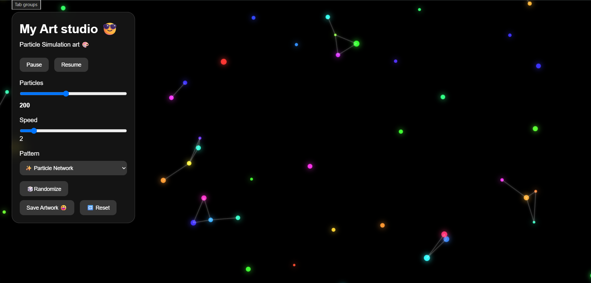

ART STUDIO

it is a fun art project where you can play with  colorful particles and connect them.
you can use the panel which have various buttons by which
>you can increase number of particles
>speed of the particles can be increased.
>different arrangements of particles can be made.
>you can save the screen shot of the art directly to your device.

i made this project using html,css and javascript.

i have few ideas to implememnt in future:
>adding music and sound to particles.
>making different shapes using the particles.

